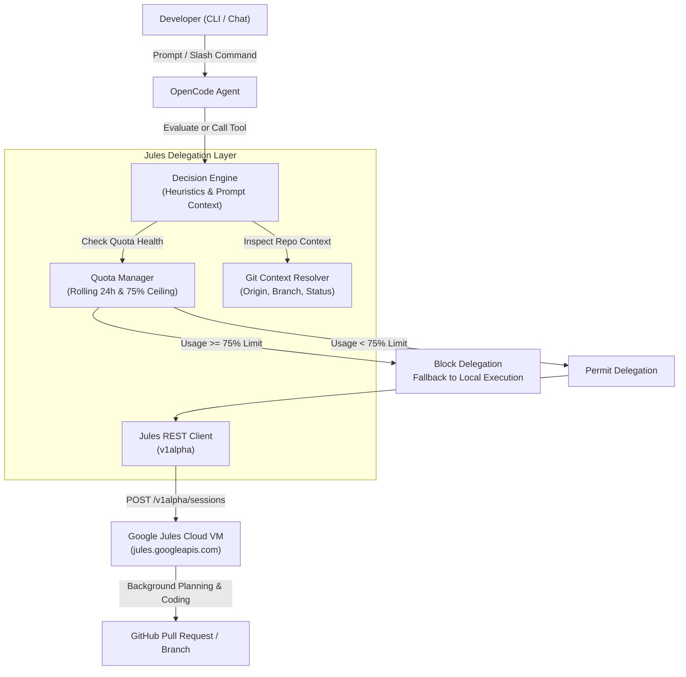
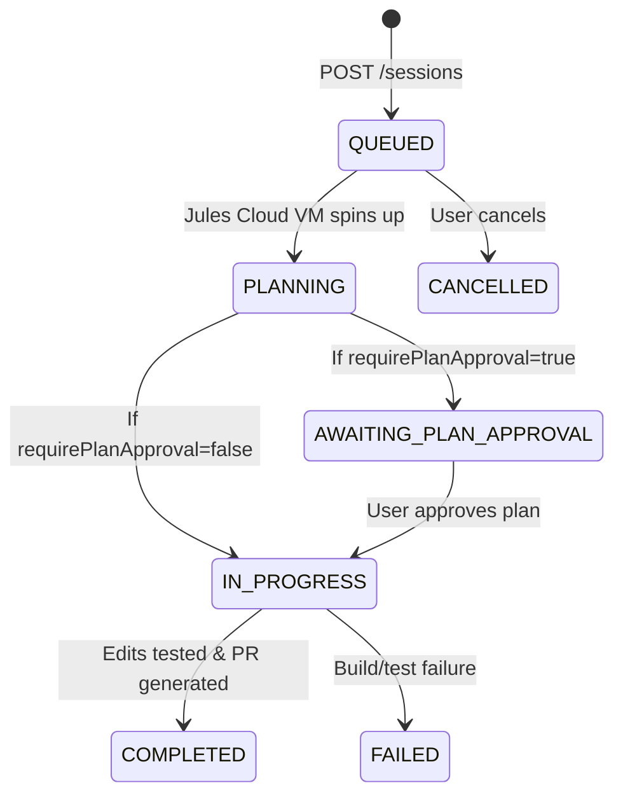

# OpenCode Jules Delegation Specification

## 1. Executive Summary

This specification defines the architecture, data models, protocols, and algorithms for **`opencode-jules-delegate`**, an OpenCode v2 Plugin and Model Context Protocol (MCP) server that empowers OpenCode agents to delegate heavy, long-running, and computationally intensive coding tasks to **Google Jules** (`jules.googleapis.com/v1alpha`).

Delegation can occur via:
1. **Direct User Request**: Explicit instruction from the developer (e.g. prompt command or `/jules <prompt>`).
2. **Autonomous LLM Choice**: The OpenCode model assesses task complexity (multi-file refactors, large test suite generation, architectural migrations) and delegates asynchronously.

A **strict 75% daily quota guardrail** is enforced across a rolling 24-hour window to protect developer capacity and ensure critical quota remains available for interactive/manual use.

---

## 2. Architecture & System Flow



---

## 3. Google Jules API Contract

All REST interactions target the Google Jules API v1alpha.

### 3.1 Base URL & Authentication
* **Base URL**: `https://jules.googleapis.com/v1alpha`
* **Authentication Header**: `x-goog-api-key: <JULES_API_KEY>`
* **Content-Type**: `application/json`

### 3.2 Key Resources & Methods

| Resource | HTTP Method | Endpoint | Description |
| :--- | :--- | :--- | :--- |
| **Sources** | `GET` | `/v1alpha/sources` | Lists connected GitHub repositories |
| **Sessions** | `POST` | `/v1alpha/sessions` | Initiates an asynchronous coding session |
| **Sessions** | `GET` | `/v1alpha/sessions/{sessionId}` | Inspects current session state |
| **Sessions** | `GET` | `/v1alpha/sessions?pageSize={n}` | Lists recent sessions |
| **Activities** | `GET` | `/v1alpha/sessions/{sessionId}/activities` | Streams/polls step execution logs |

### 3.3 Session Creation Payload
```json
{
  "prompt": "Refactor authentication middleware to support JWT and OAuth2 session tokens with complete unit tests",
  "title": "Refactor Auth Middleware",
  "sourceContext": {
    "source": "sources/github-owner-repo",
    "githubRepoContext": {
      "startingBranch": "main"
    }
  },
  "requirePlanApproval": false,
  "automationMode": "AUTO_CREATE_PR"
}
```

### 3.4 Session Lifecycle State Machine



---

## 4. Quota Management & 75% Ceiling Guardrail

### 4.1 Subscription Tiers and Quota Limits
Google Jules enforces daily task limits over a **rolling 24-hour window**:

| Plan Tier | Daily Task Limit ($L_{daily}$) | 75% Ceiling ($\lfloor 0.75 \times L_{daily} \rfloor$) | Emergency Capacity Reserved |
| :--- | :--- | :--- | :--- |
| **Base / Free** | 15 tasks | **11 tasks** | 4 tasks |
| **Pro Plan** | 100 tasks | **75 tasks** | 25 tasks |
| **Ultra Plan** | 300 tasks | **225 tasks** | 75 tasks |
| **Custom** | User Configured | $\lfloor 0.75 \times L_{daily} \rfloor$ | 25% |

### 4.2 Mathematical Guardrail Condition
Let $R$ be the set of task delegation events $r_i$ with timestamp $t_i$.
At current time $T_{now}$, the rolling window set $W$ is defined as:

$$W = \{ r_i \in R \mid t_i \ge T_{now} - 86,400,000 \text{ ms} \}$$

Current rolling usage is $U_{rolling} = |W|$.

Delegation is **strictly allowed** if and only if:

$$U_{rolling} < \lfloor 0.75 \times L_{daily} \rfloor$$

If $U_{rolling} \ge \lfloor 0.75 \times L_{daily} \rfloor$:
* Delegation is **BLOCKED**.
* The remaining $\ge 25\%$ quota is preserved for critical manual sessions.
* The system calculates the estimated recovery time:
  $$T_{next\_reset} = \min_{r_i \in W}(t_i) + 86,400,000 \text{ ms}$$
* OpenCode falls back to local execution.

### 4.3 Persistence & Reconciliation
* Task records are stored in atomic, durable JSON files (`~/.config/opencode/jules_quota.json`).
* Quota logs record: `{ sessionId, timestamp, title, promptPreview, source }`.
* Expired records ($t_i < T_{now} - 24\text{h}$) are lazily purged on read/write.
* The client supports synchronizing with `GET /v1alpha/sessions` to catch sessions initiated externally via the Jules web UI.

---

## 5. Delegation Decision Matrix

Delegation can occur via user request or autonomous LLM judgment.

### 5.1 Decision Framework

```
                       [Incoming Task Prompt]
                                 │
                     Is Quota Usage >= 75%?
                     ┌───────────┴───────────┐
                    YES                      NO
                     │                       │
              [BLOCK DELEGATION]       Explicit User Request?
           (Fallback to Local Execution) ┌───┴───┐
                                        YES      NO
                                         │       │
                                [DELEGATE]   Evaluate Task
                                             Complexity Score
                                                 ┌───┴───┐
                                       Score >= 3      Score < 3
                                            │               │
                                        [DELEGATE]      [LOCAL]
```

### 5.2 Heuristic Scoring Criteria for Autonomous LLM Choice

| Factor | Condition | Score Contribution |
| :--- | :--- | :--- |
| **Keywords** | `refactor`, `rewrite`, `migrate`, `upgrade`, `test suite`, `overhaul`, `e2e` | +2 per category match |
| **Scope** | Task impacts $> 3$ files or repo-wide configuration | +3 |
| **Description Length** | Detailed prompt $> 300$ characters describing complex workflow | +1 |
| **Lightweight Filter** | `typo`, `explain`, `what is`, `single function`, `one liner` | Immediate local execution (-10) |
| **Git Working Tree** | Dirty uncommitted working tree | Requires user notification / commit push |

---

## 6. OpenCode Plugin Specification

The plugin integrates via `@opencode-ai/plugin` v2.

### 6.1 Tools Registered
1. `jules_delegate`:
   * **Args**: `prompt` (string, required), `title` (string, optional), `branch` (string, optional), `source` (string, optional), `requirePlanApproval` (boolean, optional), `isExplicitUserRequest` (boolean, optional).
   * **Behavior**: Validates 75% quota, resolves Git context, triggers session, logs timestamp, returns session URL.
2. `jules_check_session`:
   * **Args**: `sessionId` (string, required).
   * **Behavior**: Polls status, recent agent activities, bash outputs, and pull request links.
3. `jules_get_quota`:
   * **Args**: None.
   * **Behavior**: Returns current rolling usage, ceiling threshold, remaining capacity, and reset countdown.
4. `jules_list_sessions`:
   * **Args**: `pageSize` (number, optional).
   * **Behavior**: Queries recent sessions.
5. `jules_list_sources`:
   * **Args**: None.
   * **Behavior**: Lists connected GitHub repositories.

### 6.2 OpenCode Lifecycle Hooks
* `experimental.chat.system.transform`: Dynamically appends the **Jules Delegation Protocol** to the system prompt, providing real-time quota status and delegation criteria to the LLM.
* `command.execute.before`: Intercepts `/jules <prompt>` slash commands.

---

## 7. Model Context Protocol (MCP) Specification

The MCP implementation complies with Model Context Protocol specification over `stdio` transport.

### 7.1 Protocol Capabilities
* **Tools**: Mirrors all 5 tools above with standard JSON Schemas.
* **Resources**:
  * URI: `jules://quota`
  * MIME: `application/json`
  * Content: Current rolling 24-hour quota telemetry.
* **Prompts**:
  * `jules_delegate_heavy_task`: Pre-configured prompt template for complex task evaluation.

---

## 8. Failure Modes & Security

| Failure Scenario | System Behavior | Recovery Action |
| :--- | :--- | :--- |
| **Quota $\ge 75\%$** | Hard block at pre-check | Inform user; fallback to OpenCode local code generation |
| **Missing API Key** | Pre-flight error | Prompt user to set `JULES_API_KEY` |
| **Disconnected Repo** | Detects remote mismatch | Warns user and lists valid sources via `jules_list_sources` |
| **Dirty Git Tree** | Working tree warning | Alerts user that remote branch will be used by Jules |
| **Network / 5xx** | Graceful rejection | Logs error, does not increment quota ledger |
